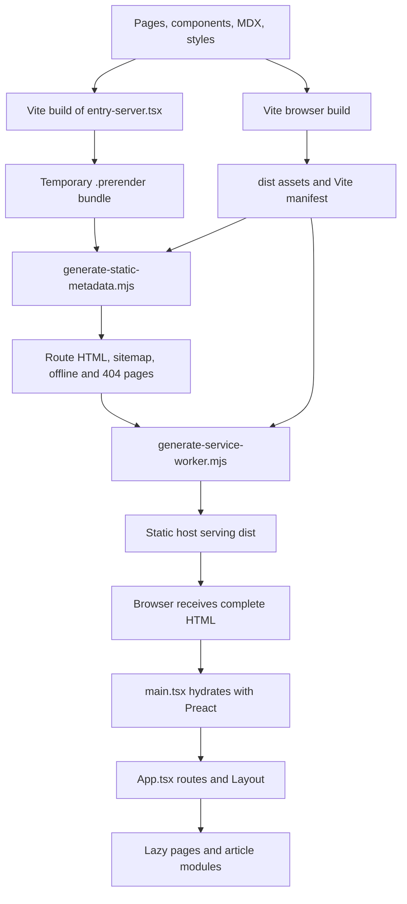

# Architecture Overview

**clh.lol** is a statically hosted application built with Vite. Components use the React API; Vite aliases React and React DOM to Preact compatibility for both browser and build-time rendering. Each public route is rendered to HTML during the production build, then Preact hydrates that HTML to provide client-side navigation and interactions. Vitest uses the same aliases and Preact's testing adapter.

## Core Modules

- **App.tsx** – Sets up `react-router-dom` routes and provides the global layout via `<Layout/>`. Browser builds load page components lazily; the build-time renderer supplies the same pages eagerly so their HTML is immediately available.
- **entry-server.tsx** – Build-only rendering entry point. It renders a requested route to a string and is not deployed as a server.
- **main.tsx** – Hydrates prerendered markup in production and falls back to a normal client render during development.
- **Layout.tsx** – Handles the background, mouse spotlight, responsive behavior, and global navigation and interaction wrappers.
- **Pages** – `Home`, `Projects`, `BlogPage`, `BlogPostPage`, etc. Each page is a functional component that composes reusable UI components. Incoming routes use a short CSS fade; animation features for the page use Framer Motion. A pending lazy route cannot block navigation to another destination.
- **Components** – Re‑usable UI pieces:
  - `Nav` – Top‑right navigation with motion hover effects.
  - `Cursor` – Custom spring‑based cursor that disappears on touch devices.
  - `SharedCard` – Project rows with descriptions, optional previews, and links that preserve the project-list filters when returning from a detail page.
- **Hooks & Utilities** – Mostly native React hooks (`useState`, `useEffect`, `useTransform`, `useMotionValue`). Small custom hooks handle prerendered navigation and preferences.
- **Tailwind Config (`tailwind.config.js`)** – Centralizes colours, fonts, and custom keyframe animations (e.g., background movement).
- **Page Metadata** – `src/lib/routeMetadata.ts` defines static page metadata and builds the same title, social tags, and article structured data for the browser and static HTML. The server entry supplies blog metadata from the existing MDX index, so the build does not parse frontmatter separately.
- **Content** – MDX files under `src/content/blog/` provide the blog posts, compiled by `@mdx-js/rollup` in `vite.config.ts`. A metadata-only pipeline strips article bodies for blog listings; the full pipeline adds GitHub-flavored Markdown and syntax highlighting.

## Build & Deployment

- **Vite** compiles the browser application and a temporary build-time rendering entry point.
- `scripts/generate-static-metadata.mjs` renders the routes exported by `src/entry-server.tsx` into `dist/`, injects route-specific metadata and structured data, generates `sitemap.xml`, and writes the top-level `404.html` and `offline.html` used by static hosts. Static routes come from `src/lib/routeMetadata.ts`; article routes come from MDX frontmatter.
- The temporary `.prerender/` bundle is deleted after generation. The deployed output is still only static HTML, CSS, JavaScript, and assets; no Node.js or application server runs in production.
- Preact hydrates the generated HTML without replacing the page, preserving the existing animations, navigation, and route-level code splitting. The HTML also remains readable when JavaScript is unavailable.
- Vite copies `public/` into `dist/`. The subsequent scripts augment `_headers` with homepage preload hints and replace placeholders in the copied `sw.js` with a content-derived cache version and homepage precache URLs. Edit the source templates, not generated output.
- `src/main.tsx` registers the service worker only in production. It precaches the homepage shell and caches other pages on visits; unvisited pages are not guaranteed offline. Development unregisters workers to avoid stale assets.
- Cloudflare Pages is the documented production host. Publish `dist/` with its generated route HTML and headers; the GitHub Actions workflow runs checks only. See the [README deployment guide](../README.md#deployment) for host requirements.

## External services and state

- Newsletter forms submit directly to Kit; there is no local subscription backend. The confirmation route controls only a consent-gated display preference, not account verification.
- `src/lib/analytics.ts` sends a small allowlist of events directly to PostHog only in production, with both optional build variables configured and current cookie consent. No PostHog SDK is loaded. Cloudflare Web Analytics is enabled separately in the hosting dashboard.
- Browser preferences are handled by `src/lib/newsletterPreferences.ts`; no database is required. The optional Substack checker reads deployed pages and writes ignored local sync state; it is not part of serving or building the site and does not publish automatically.

---

### Extending the Architecture

If you add a backend (for example, for comments), mount an API under `/api/` and proxy it through Vite during development. Keep public content renderable at build time unless a feature genuinely requires runtime data.
